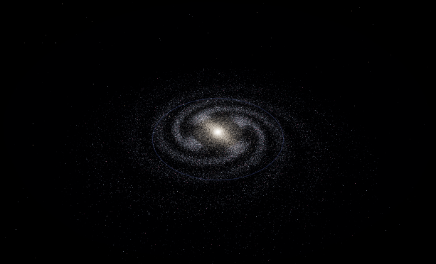
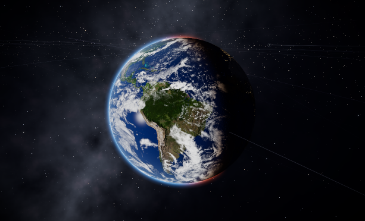
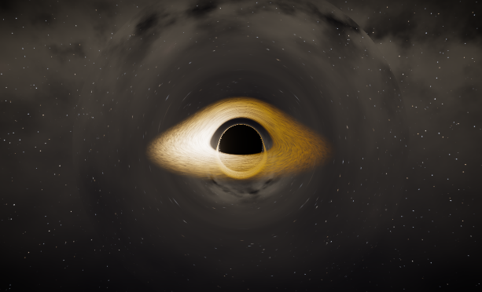
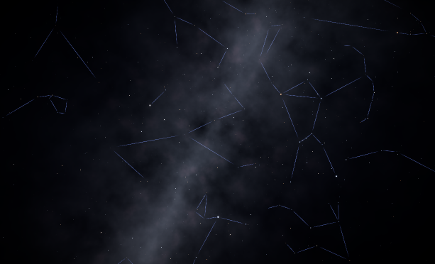

# ASTRALIS

[English](./README.md) · **繁體中文**

> **電影感互動宇宙探索器** — 在同一個 WebGL 體驗裡，從可觀測宇宙一路旅行到地球夜空

<p align="center">
  
</p>

<p align="center">
  <a href="https://github.com/ReiKama414/astraeon0"></a>
  <a href="https://reikama414.vercel.app/"></a>
  
  
  
  
  
</p>

<p align="center">
  <strong><a href="https://github.com/ReiKama414/astraeon0">★ 幫這個專案按 Star</a></strong>
  ·
  <a href="https://reikama414.vercel.app/">個人網站</a>
  ·
  <a href="#快速開始">快速開始</a>
  ·
  <a href="#授權--權限">授權</a>
</p>

---

## 為什麼是 ASTRALIS？

多數「太空」展示不是平面星圖，就是單一太陽系玩具。**ASTRALIS** 是**尺度感知**的探索器：用同一張導航圖串起 **宇宙 → 星系 → 恆星系 → 行星 → 夜空 → 黑洞 → 星雲 → 幻想星域** — 搭配電影感鏡頭旅行、雙語標籤，以及「看得見、又不亂編距離」的展示比例

給愛天文也愛工藝的人：找畫面參考的設計師、好奇的學習者，以及任何想讓宇宙感覺「伸手可及」的人。

> **提醒：** 資料、比例與文案可能有誤。詳見[正確性聲明](#正確性聲明)。

| 尺度 | 你會看到 |
| --- | --- |
| **可觀測宇宙** | 宇宙網、本星系群、深空錨點標籤 |
| **星系** | 程序化螺旋盤（銀河、仙女座…） |
| **太陽系** | 克卜勒軌道、衛星、小行星帶、彗星 |
| **系外行星** | 比鄰星、TRAPPIST-1 等 |
| **黑洞** | 重力透鏡吸積盤（人馬座 A*、M87*） |
| **星雲與星團** | 獵戶、蟹狀、老鷹、昴宿… |
| **夜空** | 星座連線 + 真實 3D 恆星距離 |
| **幻想世界** | 程序化星系、星雲與夢境行星 |

<p align="center">
  
  &nbsp;
  
</p>

---

## 亮點

- **連續旅行** — 單一 `travelTo(id)` 導航圖跨尺度躍遷  
- **註冊表驅動宇宙** — 天體、場景、宿主關係集中在型別化 registry  
- **電影級渲染** — R3F + 後處理（bloom、vignette、tone mapping、SMAA）  
- **自適應畫質** — auto / low / medium / high，含 DPR 與行動裝置路徑  
- **雙語介面** — English ↔ 繁體中文  
- **導覽旅程** —《宇宙之旅》  
- **比較與拍照模式** — 並排天體、乾淨截圖  
- **全域搜尋** — 行星、梅西耶、星系、幻想世界  
- **模擬時鐘** — 1× / 10× / 100× / 自訂流速  

---

## 技術棧

| 層級 | 選用 |
| --- | --- |
| UI | React 19、Zustand、Tailwind CSS 4 |
| 3D | Three.js、React Three Fiber、Drei、postprocessing |
| 動態 | GSAP |
| 工具 | Vite 8、TypeScript |
| 資料出處 | NASA / JPL 事實表與根數、IAU 自轉、Meeus（見程式內 `dataSource`） |

---

## 快速開始

**需求：** 建議 Node.js 20+，以及支援 WebGL2 的顯示卡

```bash
git clone https://github.com/ReiKama414/astraeon0.git
cd astraeon0
npm install
npm run dev
```

開啟 Vite 印出的本機網址（通常是 `http://localhost:5173`）。

| 指令 | 用途 |
| --- | --- |
| `npm run dev` | 開發伺服器 + 熱更新 |
| `npm run build` | 型別檢查 + 正式打包 |
| `npm run typecheck` | `tsc --noEmit` |
| `npm run preview` | 預覽正式建置 |

---

## 操作速查

| 輸入 | 動作 |
| --- | --- |
| 拖曳 | 環視 |
| 滾輪 / 雙指 | 縮放 |
| 雙擊標籤 | 旅行至該天體 |
| `/` | 搜尋 |
| `F` · WASD | 自由飛行（啟用時） |
| 底部 Dock | 時間流速、導覽、拍照、設定 |

---

## 專案結構

```
src/
├── core/          # registry、導航、座標、資料、程序生成
├── scenes/        # universe · galaxy · solar · sky · nebula · blackhole · fantasy
├── ui/            # HUD、搜尋、資訊、比較、導覽、i18n
├── store/         # Zustand 狀態
├── workers/       # 主執行緒外的重計算
└── dev/harness.ts # 開發用視覺 QA（window.__h）
```

---

## 截圖

<p align="center">
  
</p>

更多預覽見 [`docs/`](./docs/) 

---

## 正確性聲明

ASTRALIS 是**互動視覺化／學習體驗**，不是研究級星曆或導航系統。

- 位置、距離、尺寸、貼圖與時間可能被**簡化、壓縮（展示比例）、近似，或直接有誤**。
- 目錄資料、翻譯、標籤與百科短文可能含有**錯誤或過時數值**。
- 程序化與幻想內容**本質上是虛構**。
- **請勿**將本應用用於科學發表、任務規劃、成績評量，或任何安全／導航相關用途。

若發現錯誤，歡迎開 issue 回報（依下方授權，修改程式碼仍需書面同意）。

---

## 出處與第三方資料

本專案引用的天文**事實與軌道根數**來自公有領域或已標註來源（例如 NASA Planetary Fact Sheet、JPL 近似位置、IAU 自轉參數）。渲染、著色器、程序內容、介面、品牌與原創文案，除另有註明外，皆為作者**原創作品**。

第三方函式庫（React、Three.js 等）依其各自授權使用；**不會**因此改變本倉庫的授權狀態。

### AI 協助

本專案部分內容在開發過程中有 **[Claude](https://www.anthropic.com/claude)**（Anthropic）協助。  
方向、取捨、審核與著作權仍屬 **ReiKama414**。Claude 是開發輔助工具，**不是**本倉庫的共有人或授權方。

---

## 連結

| | |
| --- | --- |
| **GitHub** | https://github.com/ReiKama414/astraeon0 |
| **作者** | [ReiKama414（Myers）](https://github.com/ReiKama414) |
| **個人網站** | https://reikama414.vercel.app/ |
| **AI 協助** | [Claude](https://www.anthropic.com/claude)（Anthropic） |

若 ASTRALIS 幫你學到東西、用於教學，或只是讓你多抬頭看一次星空 — 在 GitHub **按一顆星**，就是最好的續航訊號

---

## 授權 / 權限

Copyright (c) ReiKama414. **All rights reserved.**

本專案僅供**個人瀏覽與學習**。  
未經著作權人**書面同意**，不得使用、複製、修改、散布、再授權，或併入其他專案（**含非商業用途**）

- GitHub: https://github.com/ReiKama414/astraeon0  
- Site: https://reikama414.vercel.app/  
- Full text: see [LICENSE](./LICENSE)

商業授權或特殊許可，請透過 GitHub 或個人網站聯絡作者。

---

<p align="center"><sub>ASTRALIS · by ReiKama414 · with Claude</sub></p>
